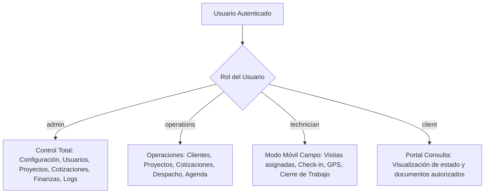

# Análisis Funcional Integral — Sistema Eléctrico Edison Pino

**Documento:** Análisis de Arquitectura Funcional, Procesos de Negocio y Vistas  
**Destinatario:** Dirección General, Equipo Técnico y Auditoría de Sistemas  
**Empresa:** Eléctrico Edison Pino  
**Versión:** 1.0 — Producción 2026  

---

## 1. Introducción y Contexto de Negocio

**Eléctrico Edison Pino** es una empresa especializada en servicios integrales de ingeniería eléctrica, instalaciones en baja y media tensión, mantenimiento preventivo/correctivo de tableros eléctricos, montajes industriales y cableado estructurado. 

### El Problema Operativo Tradicional:
Antes de este sistema, las empresas de este sector sufren de:
1. **Pérdida de márgenes en cotizaciones:** Cálculos manuales en hojas de cálculo con errores de fórmulas o redondeo de punto flotante, sin control de versiones cuando el cliente negocia descuentos.
2. **Descoordinación geográfica:** Asignación de electricistas a múltiples lugares simultáneamente o viajes innecesarios debido a direcciones incorrectas (ej. viajar a la oficina central en lugar de la planta industrial).
3. **Fugas de materiales y falta de trazabilidad:** Falta de registro claro de qué repuestos se usaron en cada obra y quién fue el responsable.
4. **Vicios de entrega y riesgos legales de cobro:** Entrega de obras eléctricas sin protocolos de prueba (continuidad, aislamiento, puesta a tierra) ni actas formales de entrega-recepción suscritas por el cliente, lo que suele derivar en retenciones de pago o disputas judiciales.

### El Objetivo del Sistema:
Centralizar, automatizar y blindar digitalmente todo el ciclo de vida del servicio eléctrico: desde la prospección del cliente y la cotización de precisión, pasando por la programación en agenda con detección de colisiones, hasta la ejecución técnica en faena móvil y la certificación formal de entrega.

---

## 2. Mapa Arquitectónico y Roles del Sistema

El sistema implementa un modelo de control de acceso basado en roles (**RBAC**) gestionado desde PostgreSQL y reflejado en la interfaz de usuario:

---

## 3. Desglose Exhaustivo por Módulos y Pantallas

---

### MÓDULO 1: Autenticación, Sesión y Control Perimetral

#### Vistas y Rutas:
- `/login`: Formulario de acceso con correo y contraseña.
- `/recuperar-password`: Solicitud de restablecimiento de contraseña vía correo.
- `/acceso-denegado`: Pantalla de advertencia cuando un usuario autenticado intenta violar el control de roles.

#### ¿Por qué lo tiene?
La información de clientes, esquemas eléctricos de subestaciones, costos de mano de obra y márgenes de ganancia constituyen secretos comerciales y activos críticos que no pueden ser públicos ni vulnerables a espionaje o sabotaje.

#### ¿Para qué lo tiene?
- Garantizar que solo el personal autorizado acceda a la plataforma.
- Aislar el contexto de trabajo: los técnicos de campo no deben tener acceso a alterar configuraciones tributarias ni ver costos de compra, mientras que los administradores requieren supervisión total.

#### ¿Cómo funciona?
1. El usuario introduce sus credenciales; Supabase Auth emite un par de tokens criptográficos almacenados en cookies HTTP-only seguras.
2. El archivo de borde `src/proxy.ts` (Next.js 16) intercepta cada petición entrante:
   - Si no hay sesión válida y la ruta es privada, redirige a `/login?redirect=[URL_ORIGEN]`.
   - Si la sesión es válida y se intenta acceder a `/login`, redirige automáticamente a `/dashboard`.
3. Al iniciar sesión, la aplicación consulta `user_roles` y renderiza únicamente las opciones del menú lateral a las que el usuario tiene derecho.

---

### MÓDULO 2: Panel de Control (Dashboard)

#### Vistas y Rutas:
- `/dashboard`: Centro de comando operativo y directivo.

#### Componentes y Opciones:
1. **Tarjetas KPI en Tiempo Real:**
   - *Proyectos Activos:* Conteo de obras en ejecución.
   - *Cotizaciones Pendientes:* Oportunidades comerciales en espera de respuesta del cliente.
   - *Órdenes de Trabajo en Progreso:* Servicios técnicos que se están ejecutando en el día.
   - *Visitas Agendadas Hoy:* Citas técnicas planificadas en el calendario.
2. **Acciones Rápidas:** Botones directos para "+ Nueva Cotización", "+ Nueva Orden", "+ Nuevo Proyecto", "+ Agendar Visita".
3. **Resumen de Estado Operativo:** Gráficos y listados resumidos de las últimas órdenes y su progreso.
4. **Bitácora de Actividad Reciente:** Feed en vivo con los últimos movimientos registrados en el sistema.

#### ¿Por qué lo tiene?
Los directores y coordinadores de operaciones no tienen tiempo de abrir 10 menús para conocer la salud operativa de la empresa. Requieren una panorámica ejecutiva en menos de 5 segundos.

#### ¿Para qué lo tiene?
- Identificar cuellos de botella al instante (ej. acumulación de órdenes de trabajo retrasadas o cotizaciones estancadas).
- Priorizar las decisiones del día apenas se inicia la jornada laboral.

#### ¿Cómo funciona?
Es un Server Component de Next.js que consulta en paralelo mediante consultas optimizadas de Supabase las tablas `projects`, `quotations`, `work_orders`, `agenda_visits` y `activity_logs`. La información se renderiza en el servidor y se envía preconstruida al navegador para un tiempo de carga inferior a 300 milisegundos.

---

### MÓDULO 3: Gestión de Clientes y Ubicaciones Físicas

#### Vistas y Rutas:
- `/clientes`: Directorio general de clientes con buscador y filtros.
- `/clientes/nuevo`: Formulario de alta de cliente y sede principal.
- `/clientes/[id]`: Ficha 360° del cliente, historial de proyectos, cotizaciones y sedes.
- `/clientes/[id]/editar`: Modificación de datos generales y fiscales.

#### Opciones y Atributos:
- **Tipo de Cliente:** Natural (Persona física) o Jurídico (Empresa / Institución).
- **Identificación:** Cédula o RUC (con validación de formato).
- **Datos de Contacto:** Razón social, persona de contacto, teléfono, correo electrónico.
- **Múltiples Ubicaciones Físicas (`client_locations`):**
  - Nombre de la sede (ej. "Matriz Centro", "Bodega Industrial Norte", "Planta Durán").
  - Dirección detallada, referencias de llegada.
  - Coordenadas geográficas (Latitud y Longitud) para despacho satelital.

#### ¿Por qué lo tiene?
En el rubro eléctrico, el cliente que paga la factura rara vez se encuentra en el mismo lugar donde ocurre la falla eléctrica. Una constructora o cadena de almacenes puede tener 20 sucursales con tableros eléctricos distintos.

#### ¿Para qué lo tiene?
- Evitar el error habitual de enviar a la cuadrilla técnica a la oficina administrativa del cliente en lugar de la subestación de la planta de producción.
- Centralizar el historial técnico: saber qué transformadores, tableros o cables se instalaron en cada sucursal a lo largo de los años.

#### ¿Cómo funciona?
- Posee una arquitectura de relación 1 a N (`clients` -> `client_locations`).
- Al registrar un cliente nuevo, se genera obligatoriamente su sede principal.
- Cuando se crea una cotización, proyecto u orden de trabajo, el usuario selecciona el cliente y automáticamente se despliega un selector dinámico con sus sedes registradas, heredando la ubicación exacta.

---

### MÓDULO 4: Gestión de Proyectos e Ingeniería Eléctrica

#### Vistas y Rutas:
- `/proyectos`: Listado maestro de obras con filtros por estado (`draft`, `in_progress`, `on_hold`, `completed`, `delivered`, `cancelled`).
- `/proyectos/nuevo`: Creación de nuevo proyecto con asignación de presupuesto, cliente, sede y líder técnico.
- `/proyectos/[id]`: Centro de control del proyecto con 4 pestañas interactivas:
  1. **Detalles Generales:** Fechas contractuales, cliente, responsable, descripción técnica.
  2. **Etapas y Checklists:** Fases secuenciales de la obra y lista de verificaciones técnicas.
  3. **Órdenes de Trabajo Vinculadas:** Todas las OTs generadas para este proyecto.
  4. **Actas de Entrega:** Registro y emisión del Acta de Entrega y Recepción definitiva.

#### Opciones y Reglas de Negocio Fundamentales:
- **Codificación Automática:** Numeración correlativa `PRJ-YYYY-XXXX` inmutable.
- **Fases del Proyecto:** Definición de etapas (ej. *Obra Civil / Canalización*, *Tendido de Cableado*, *Montaje de Tableros*, *Pruebas y Mediciones*, *Puesta en Servicio*).
- **Checklist Técnico por Etapa:** Tareas atómicas con estado (ej. "Prueba de aislamiento con Megóhmetro > 50 MΩ", "Ajuste de torque en barras con torquímetro", "Rotulación de circuitos según norma").

#### Regla de Oro N° 8 (Candado de Entrega de Proyecto):
- **¿Por qué existe?** En instalaciones eléctricas, energizar o entregar una obra sin pruebas de aislamiento o sin firma de responsabilidad legal del cliente puede ocasionar incendios por cortocircuito, accidentes fatales por contacto indirecto o demandas por vicios ocultos.
- **¿Para qué sirve?** Obliga contractualmente y procedimentalmente a que ningún proyecto sea cerrado comercial o técnicamente si quedaron tareas inconclusas o si el cliente no firmó el acta de conformidad.
- **¿Cómo funciona?**
  1. Si un usuario intenta cambiar el estado del proyecto a `completed` o `delivered` desde la interfaz o por API, el trigger en base de datos `validate_project_delivery_integrity()` ejecuta un chequeo estricto:
     - Verifica que el 100% de las etapas en `project_stages` estén en estado `completed`.
     - Verifica que exista al menos un registro en `delivery_certificates` con fecha de recepción y nombre del receptor.
  2. Si falta cualquiera de estos dos requisitos, la base de datos aborta la transacción y lanza el error correspondiente, bloqueando la acción tanto en la UI como a nivel de datos.

---

### MÓDULO 5: Motor de Cotizaciones y Proformas

#### Vistas y Rutas:
- `/cotizaciones`: Catálogo de cotizaciones con buscador, filtros por estado (`draft`, `sent`, `approved`, `rejected`, `expired`, `converted_to_wo`) y versionado.
- `/cotizaciones/nueva`: Constructor interactivo de cotización.
- `/cotizaciones/[id]`: Ficha detallada de la cotización con visor de partidas, historial de versiones, botones de aprobación, descarga de PDF y conversión a Orden de Trabajo.

#### Opciones y Componentes Clave:
1. **Diferenciación de Partidas (Materiales vs Mano de Obra):**
   - El sistema clasifica cada fila en `material` o `labor`. Esto permite transparentar el costo de insumos físicos frente al servicio técnico especializado.
2. **Motor de Cálculo con Alta Precisión (`decimal.js`):**
   - Cada partida calcula:
     $$\text{Subtotal Bruto} = \text{Cantidad} \times \text{Costo Unitario}$$
     $$\text{Margen Unitario} = \text{Subtotal Bruto} \times \left(\frac{\text{Margen \%}}{100}\right)$$
     $$\text{Descuento Unitario} = \text{Subtotal con Margen} \times \left(\frac{\text{Descuento \%}}{100}\right)$$
     $$\text{Subtotal Neto} = \text{Subtotal con Margen} - \text{Descuento Unitario}$$
   - El pie de la cotización suma los subtotales, aplica el IVA paramétrico (ej. 15%) y calcula el Total General sin desajustes de centavos.
3. **Versionado Inmutable (`quotation_versions`):**
   - Cuando un cliente solicita un descuento o cambio de materiales, el sistema no sobreescribe la cotización existente.
   - La acción `create_quotation_version` toma una "fotografía" en formato JSON de la versión actual (`V1`), almacena el motivo del cambio y genera la versión `V2`.
4. **Flujo de Aprobación y Conversión a Orden de Trabajo:**
   - La cotización en estado `sent` puede ser marcada como `approved` por un usuario con permisos.
   - Una vez aprobada, se habilita el botón prioritario **"Convertir en Orden de Trabajo"**.
   - Al presionarlo, el procedimiento almacenado `convert_quotation_to_work_order` crea de manera atómica una nueva Orden de Trabajo (`OT-YYYY-XXXX`), copia todas las partidas a `work_order_items`, vincula el proyecto y actualiza la cotización a `converted_to_wo`.

#### ¿Por qué lo tiene?
Es el corazón financiero de la empresa. Las empresas de servicios técnicos pierden dinero cuando cotizan "al ojo" o cuando el cliente pide cambios verbales que luego no concuerdan con la factura.

#### ¿Para qué lo tiene?
- Garantizar que cada servicio tenga su margen de utilidad asegurado antes de mover un solo técnico.
- Tener un registro histórico infalsificable de lo que se le cotizó originalmente al cliente y de los cambios acordados.

---

### MÓDULO 6: Órdenes de Trabajo (OT) y Gestión de Cuadrillas

#### Vistas y Rutas:
- `/ordenes`: Tablero de órdenes de trabajo con estado (`pending`, `in_progress`, `completed`, `cancelled`) y prioridades (`low`, `medium`, `high`, `critical`).
- `/ordenes/[id]`: Ficha de la orden de trabajo con desglose de ítems, cuadrilla asignada, bitácora de ejecución, botón para descargar PDF de orden y acciones de cambio de estado.

#### Opciones y Atributos:
- **Asignación de Cuadrillas (`work_order_technicians`):**
  - Posibilidad de asignar un técnico responsable principal y múltiples técnicos auxiliares.
- **Desglose de Ítems Técnicos:** Especificación de tareas a realizar, repuestos asignados y observaciones técnicas.
- **Generación de PDF Oficial:** Documento con formato de campo para firma de recepción física si el cliente no cuenta con firma electrónica.

#### ¿Por qué lo tiene?
Una cotización aprobada no puede quedar en el aire; debe traducirse en instrucciones concretas para los electricistas que acudirán al sitio.

#### ¿Para qué lo tiene?
- Asignar responsabilidades claras: saber quién es el líder de la cuadrilla y quién responde ante cualquier percance.
- Monitorear el progreso en tiempo real de los trabajos en la calle.

#### ¿Cómo funciona?
Las Server Actions validan el rol del usuario, actualizan la tabla `work_orders` y disparan logs en `activity_logs`. El técnico asignado ve la orden reflejada inmediatamente en su interfaz móvil.

---

### MÓDULO 7: Agenda y Programación de Visitas

#### Vistas y Rutas:
- `/agenda`: Calendario visual interactivo para programación de inspecciones, mantenimientos y visitas de emergencia.

#### Opciones y Algoritmo de Detección de Conflictos:
1. **Modal de Nueva Cita:**
   - Selección de Cliente y Sede física.
   - Selección de Orden de Trabajo o Proyecto asociado.
   - Fecha y hora de inicio / fin de la visita.
   - Selección múltiple de técnicos participantes.
2. **Detección Automática de Colisiones Horarias (`check_technician_conflicts`):**
   - Antes de guardar una visita, el sistema invoca la función RPC de base de datos.
   - Si alguno de los técnicos seleccionados ya tiene una visita programada que se solapa en ese rango de horas, el sistema bloquea la acción o emite una alerta roja indicando: *"Conflicto: El técnico [Nombre] ya tiene una visita asignada de 10:00 a 12:00 en [Ubicación]"*.
3. **Anulación Controlada de Visitas:** Permite cancelar citas con registro de motivo para evitar borrados accidentales.

#### ¿Por qué lo tiene?
Los solapamientos de agenda son la causa principal de que un técnico llegue tarde o falte a un cliente, deteriorando la reputación de la empresa.

#### ¿Para qué lo tiene?
Optimizar las rutas, coordinar adecuadamente el tiempo de traslado entre zonas urbanas e industriales, y evitar la sobrecarga de trabajo de los especialistas.

---

### MÓDULO 8: Portal Móvil de Campo para Técnicos

#### Vistas y Rutas:
- `/tecnico`: Interfaz especialmente diseñada con enfoque "Mobile-First" (PWA / Smartphone).

#### Componentes de "Un Toque" para Cuadrillas:
1. **Listado de Visitas del Día:** Solo muestra las citas y órdenes asignadas al técnico autenticado (respetando RLS).
2. **Botón "Cómo llegar" (Navegación GPS):**
   - Al tocarlo, abre automáticamente la app de navegación preferida del técnico (**Waze** o **Google Maps**) con las coordenadas exactas de la sede del cliente.
3. **Botón "WhatsApp Directo":**
   - Al tocarlo, abre WhatsApp directamente con el número del contacto en sitio y un mensaje precargado: *"Estimado [Cliente], soy [Técnico] de Eléctrico Edison Pino. Me encuentro en camino a su sede..."*.
4. **Botón "Iniciar Trabajo" (Check-in):**
   - Registra la hora exacta de llegada a las instalaciones del cliente.
5. **Formulario de Cierre de Trabajo:**
   - Registro de notas de faena, mediciones eléctricas realizadas (voltajes, amperajes), materiales extras utilizados y confirmación de retiro.

#### ¿Por qué lo tiene?
Un electricista que está sobre una escalera, en una zanja o dentro de un cuarto de transformadores no puede usar una computadora portátil ni lidiar con formularios complejos con letra pequeña.

#### ¿Para qué lo tiene?
- Darle al técnico una herramienta de campo rápida, con botones grandes y táctiles que agilice su trabajo.
- Capturar la información en el momento exacto en que ocurren los hechos, evitando reportes olvidados al final de la semana.

---

### MÓDULO 8.1: Catálogo de Técnicos y Asignación de Cuadrillas a Proyectos

#### Vistas y Rutas:
- `/tecnicos`: Directorio central de técnicos de campo, cuadrillas operativas y asignación a obras.
- `/proyectos/[id]`: Sección integrada **"Cuadrilla de Técnicos Asignados"** para vinculación N a N de personal a cada obra.

#### Opciones y Componentes Clave:
1. **Catálogo de Electricistas sin Dependencia de Cuentas Auth:**
   - Permite registrar a todo el personal técnico de faena (nombre, cédula, teléfono con enlace WhatsApp, email, especialidad, categoría [Líder, Técnico, Ayudante] y estado de disponibilidad).
   - No requiere crear credenciales de inicio de sesión para cada ayudante o instalador, agilizando el control del personal de campo.
2. **Asignación Flexible de Cuadrillas a Proyectos (`project_technicians`):**
   - En cada proyecto, el coordinador puede asociar 1 o más técnicos definiendo su rol específico en la obra (*Líder de Cuadrilla*, *Técnico Instalador*, *Ayudante Eléctrico*).
   - Visualización instantánea de contacto (llamada directa y WhatsApp) y notas de asignación.
3. **Reflejo en Toda la Plataforma:**
   - En la lista de proyectos (`/proyectos`), cada fila muestra visualmente los badges de los electricistas que conforman su cuadrilla.
   - En la agenda de visitas (`/agenda`), el coordinador cuenta con el catálogo completo de técnicos para despachar cuadrillas a servicios específicos.

#### ¿Por qué lo tiene?
En las empresas de ingeniería eléctrica, la mano de obra rota con frecuencia y muchas veces está compuesta por ayudantes o contratistas que no necesitan ingresar al software, pero la dirección y el coordinador de obra sí necesitan saber con exactitud quiénes están trabajando en cada subestación, tablero o instalación.

#### ¿Para qué lo tiene?
- Saber en tiempo real quién es el líder responsable en sitio y quiénes son los operarios de cada obra.
- Contactar inmediatamente por WhatsApp o llamada a cualquier electricista asignado ante imprevistos técnicos.
- Controlar la disponibilidad de la plantilla para no sobreasignar técnicos que ya están en faenas críticas.

---

### MÓDULO 9: Administración de Usuarios y Roles

#### Vistas y Rutas:
- `/usuarios`: Directorio de personal y cuadrillas.

#### Opciones y Permisos:
- Consulta de usuarios registrados en el sistema.
- Visualización de sus roles activos (`admin`, `operations`, `technician`, `client`).
- Selector administrativo para agregar o remover roles a colaboradores.

#### ¿Por qué lo tiene?
La rotación de personal o el crecimiento del equipo exige incorporar nuevos electricistas o ascender técnicos a coordinadores de operaciones sin requerir un programador que modifique la base de datos.

#### ¿Para qué lo tiene?
Mantener el principio de menor privilegio (Least Privilege Security). Un técnico no debe poder ver cotizaciones de otros clientes ni editar presupuestos de proyectos.

#### ¿Cómo funciona?
- Solo los usuarios con rol `admin` pueden cargar esta vista.
- La modificación de roles invoca el procedimiento seguro `admin_set_user_roles(target_user_id, roles)`.
- El procedimiento comprueba en la base de datos `private.require_admin()`, garantizando que ninguna llamada manipulada desde PostgREST pueda otorgar privilegios indebidos.

---

### MÓDULO 10: Configuración de la Empresa y Datos Fiscales

#### Vistas y Rutas:
- `/configuracion`: Panel de parámetros corporativos de "Eléctrico Edison Pino".

#### Opciones Configurables:
- **Razón Social y Nombre Comercial.**
- **RUC / Identificación Fiscal.**
- **Dirección Matriz y Teléfonos de Contacto.**
- **Correo Electrónico Oficial y Sitio Web.**
- **URL del Logo Corporativo.**
- **Porcentaje de IVA por Defecto (ej. 15%).**
- **Términos y Condiciones Estándar de Cotizaciones** (plazos de validez, formas de pago, exclusiones de obra civil).
- **Políticas de Garantía Estándar** (meses de garantía en mano de obra y repuestos).

#### ¿Por qué lo tiene?
Permite que el sistema se adapte a cambios en la legislación tributaria (subidas o bajadas del IVA) o cambios en la dirección fiscal de la empresa sin tener que reprogramar el software ni alterar el código fuente.

#### ¿Para qué lo tiene?
Alimentar dinámicamente las cabeceras, pies de página y cláusulas legales de todos los PDFs generados por el sistema.

---

### MÓDULO 11: Motor de Generación de Documentos PDF

#### Rutas y Endpoints:
- `/api/pdf/[type]/[id]` con parámetros:
  - `type = quotation`: Cotización formal con desglose, términos comerciales y firmas.
  - `type = proforma`: Proforma comercial para aprobación preliminar de compras.
  - `type = work-order`: Hoja de servicio de campo para la cuadrilla y recepción física del cliente.

#### Características de Diseño y Rendimiento:
- Construido con `@react-pdf/renderer` ejecutado del lado del servidor.
- Generación de vectores limpios (no capturas rasterizadas), permitiendo copiar texto, imprimir en alta fidelidad y un peso de archivo ultra ligero (menos de 80 KB por documento).
- Membrete oficial con datos de Eléctrico Edison Pino, códigos correlativos y tablas con estilos profesionales.

#### ¿Por qué lo tiene?
Los clientes industriales, las fábricas y los administradores de edificios requieren documentos formales en PDF para sus departamentos de compras, tesorería y auditoría contable.

#### ¿Para qué lo tiene?
Brindar una imagen corporativa seria, confiable y de primer nivel que diferencie a Eléctrico Edison Pino de competidores informales.

---

### MÓDULO 12: Trazabilidad y Bitácora de Auditoría

#### Mecanismo:
- Tabla `activity_logs` alimentada automáticamente por Server Actions y triggers de auditoría.

#### Datos Registrados:
- `user_id`: Quién realizó la acción.
- `action`: Tipo de evento (ej. `CREATE_QUOTATION`, `APPROVE_QUOTATION`, `CONVERT_TO_WORK_ORDER`, `COMPLETE_PROJECT`).
- `entity_type`: Tabla afectada (`quotations`, `projects`, `work_orders`, etc.).
- `entity_id`: UUID del registro.
- `metadata`: Snapshot JSON con los valores anteriores y los nuevos valores.
- `created_at`: Marca de tiempo UTC inmutable.

#### ¿Por qué y para qué lo tiene?
Para saber con certeza quién aprobó un descuento, quién canceló una visita o quién modificó una orden de trabajo, eliminando ambigüedades operativas y fomentando la responsabilidad profesional de cada colaborador.

---

## 4. Matriz de Valor Operativo

| Módulo | Problema que Resuelve | Beneficio Directo para Eléctrico Edison Pino |
| :--- | :--- | :--- |
| **Clientes & Sedes** | Envíos a direcciones equivocadas. | Ahorro en combustible, cero viajes en vano. |
| **Proyectos & Regla 8** | Entrega de obras sin pruebas ni actas firmadas. | Blindaje legal total, cobro garantizado de planillas. |
| **Cotizador Decimal** | Pérdida de dinero por redondeos y errores en fórmulas. | Márgenes de utilidad protegidos al centavo. |
| **Agenda con Conflictos**| Cuadrillas agendadas a la misma hora en dos lugares. | Cumplimiento puntual de citas y satisfacción del cliente. |
| **Modo Técnico Móvil** | Formularios pesados que el técnico no llena en faena. | Reportes de campo en tiempo real a un solo toque (GPS/WhatsApp). |
| **Motor de PDFs** | Cotizaciones informales por WhatsApp o Word desordenado. | Documentos ejecutivos formales con membrete corporativo. |
| **Seguridad RLS** | Fuga de datos o acceso no autorizado a costos. | Confidencialidad absoluta de la información de la empresa. |

---

## 5. Conclusión

El sistema desarrollado para **Eléctrico Edison Pino** no es una simple aplicación administrativa genérica; es un ecosistema digital de ingeniería operativa adaptado específicamente a las realidades, riesgos y necesidades de las instalaciones eléctricas en campo. 

Cada vista, botón y validación existe con un propósito medible: **proteger los márgenes económicos, blindar la seguridad jurídica de las obras y optimizar la productividad de las cuadrillas técnicas.**
